<picture><source media="(prefers-color-scheme: dark)" srcset="assets/hero-dark.svg"></picture>

<picture><source media="(prefers-color-scheme: dark)" srcset="assets/social-l-dark.svg"></picture><a href="https://t.me/raZOVry"><picture><source media="(prefers-color-scheme: dark)" srcset="assets/social-1-dark.svg"></picture></a><picture><source media="(prefers-color-scheme: dark)" srcset="assets/social-r-dark.svg"></picture>

<picture><source media="(prefers-color-scheme: dark)" srcset="assets/stack-dark.svg"></picture>

<a href="https://github.com/Fasdeq13/Tunn.client"><picture><source media="(prefers-color-scheme: dark)" srcset="assets/project-tunn-client-dark.svg"></picture></a>&nbsp;<a href="https://github.com/Fasdeq13/vulkan-cocoa-core"><picture><source media="(prefers-color-scheme: dark)" srcset="assets/project-vulkan-cocoa-core-dark.svg"></picture></a>

<a href="https://github.com/Fasdeq13/fasdeq-studio"><picture><source media="(prefers-color-scheme: dark)" srcset="assets/project-fasdeq-studio-dark.svg"></picture></a>&nbsp;<a href="https://github.com/Fasdeq13/FasdQuery"><picture><source media="(prefers-color-scheme: dark)" srcset="assets/project-fasdquery-dark.svg"></picture></a>

<a href="https://github.com/Fasdeq13/Linux-Process-Hacker"><picture><source media="(prefers-color-scheme: dark)" srcset="assets/project-linux-process-hacker-dark.svg"></picture></a>&nbsp;<a href="https://github.com/Fasdeq13/fasdeqOS"><picture><source media="(prefers-color-scheme: dark)" srcset="assets/project-fasdeqos-dark.svg"></picture></a>

<picture><source media="(prefers-color-scheme: dark)" srcset="assets/stats-dark.svg"></picture>

<picture><source media="(prefers-color-scheme: dark)" srcset="assets/streak-dark.svg"></picture>

<picture><source media="(prefers-color-scheme: dark)" srcset="assets/wave-dark.svg"></picture>

<a href="https://fasdeq13.github.io/"><picture><source media="(prefers-color-scheme: dark)" srcset="assets/button-1-dark.svg"></picture></a>

