<picture><source media="(prefers-color-scheme: dark)" srcset="assets/hero-dark.svg"></picture>

<picture><source media="(prefers-color-scheme: dark)" srcset="assets/social-l-dark.svg"></picture><a href="https://t.me/raZOVry"><picture><source media="(prefers-color-scheme: dark)" srcset="assets/social-1-dark.svg"></picture></a><a href="https://www.youtube.com/@fasdeqsuper13off"><picture><source media="(prefers-color-scheme: dark)" srcset="assets/social-2-dark.svg"></picture></a><a href="https://www.tiktok.com/@fasdeq13"><picture><source media="(prefers-color-scheme: dark)" srcset="assets/social-3-dark.svg"></picture></a><picture><source media="(prefers-color-scheme: dark)" srcset="assets/social-r-dark.svg"></picture>

<picture><source media="(prefers-color-scheme: dark)" srcset="assets/stack-dark.svg"></picture>

<a href="https://github.com/Fasdeq13/Tunn.client"><picture><source media="(prefers-color-scheme: dark)" srcset="assets/project-tunn-client-dark.svg"></picture></a>&nbsp;<a href="https://github.com/Fasdeq13/FasdQuery"><picture><source media="(prefers-color-scheme: dark)" srcset="assets/project-fasdquery-dark.svg"></picture></a>

<a href="https://github.com/Fasdeq13/fasdeq-studio"><picture><source media="(prefers-color-scheme: dark)" srcset="assets/project-fasdeq-studio-dark.svg"></picture></a>&nbsp;<a href="https://github.com/FasdCommander/FasdCommander"><picture><source media="(prefers-color-scheme: dark)" srcset="assets/project-fasdcommander-dark.svg"></picture></a>

<a href="https://github.com/Fasdeq13/vulkan-cocoa-core"><picture><source media="(prefers-color-scheme: dark)" srcset="assets/project-vulkan-cocoa-core-dark.svg"></picture></a>&nbsp;<a href="https://github.com/Fasdeq13/MakuTweaker_linux"><picture><source media="(prefers-color-scheme: dark)" srcset="assets/project-makutweaker-linux-dark.svg"></picture></a>

<picture><source media="(prefers-color-scheme: dark)" srcset="assets/stats-dark.svg"></picture>

<picture><source media="(prefers-color-scheme: dark)" srcset="assets/wave-dark.svg"></picture>

